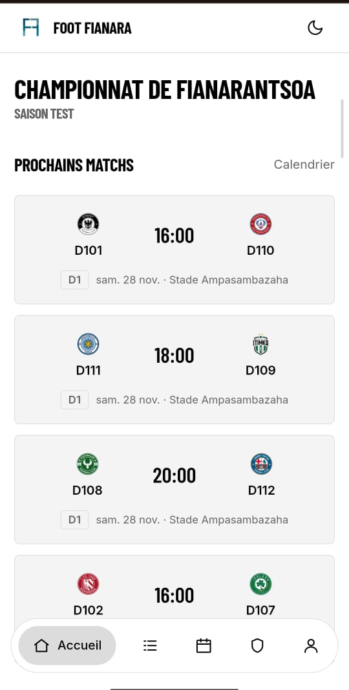
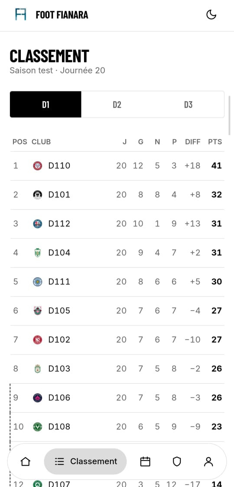
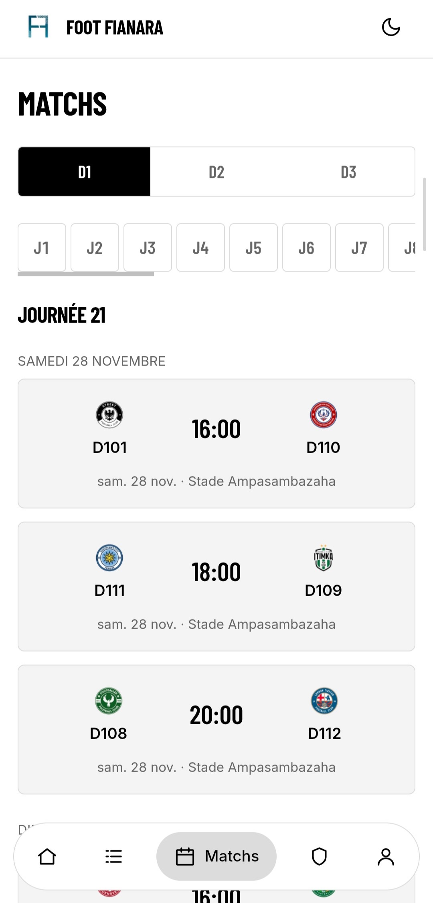
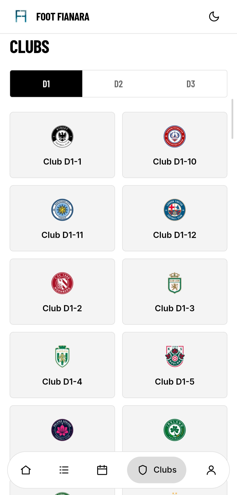
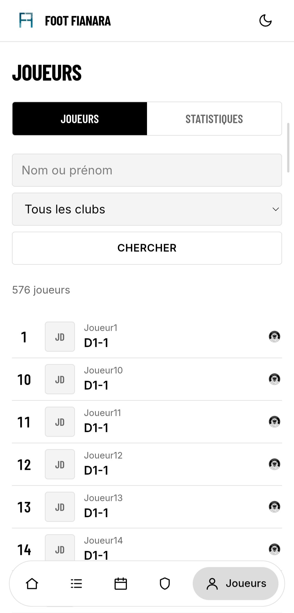

# Foot Fianara : le championnat de football de Fianarantsoa, en ligne

[](https://github.com/aina-fanomezantsoa/FootFianara/actions/workflows/quality-gate.yml)




| Classement                              | Matchs                            |
| --------------------------------------- | --------------------------------- |
|  |    |
|            |  |

## Le projet : problème et objectif

Les résultats et le classement du championnat de Fianarantsoa sont aujourd'hui publiés surtout sur les pages Facebook de chaque club : l'information est dispersée et difficile à suivre. Foot Fianara la centralise sur un seul site, conçu pour les supporters : classement, calendrier, résultats, fiches des clubs et des joueurs.

## Fonctionnalités clés

- Classement calculé automatiquement à partir des résultats
- Génération du calendrier d'une saison
- Fiches clubs, joueurs et matchs, statistiques et suspensions
- Actualités et mode clair / sombre
- Espace d'administration avec rôles et accès protégé

## Stack technique

| Couche           | Techno                                   | Pourquoi ce choix                             |
| ---------------- | ---------------------------------------- | --------------------------------------------- |
| Front + back     | Next.js 16, React 19, TypeScript         | Un seul projet pour le site public et l'admin |
| Données          | PostgreSQL, Prisma                       | Typage de bout en bout                        |
| Authentification | Auth.js                                  | Sessions et rôles                             |
| Images           | Cloudinary                               | Stockage externe des logos et photos          |
| Qualité          | Vitest, ESLint, Prettier, GitHub Actions | Contrôles à chaque push                       |
| Hébergement      | Vercel                                   | Déploiement continu                           |

## Architecture

```
Visiteur ──► Site public ─┐
                          ├─► Logique métier (classement, calendrier, suspensions) ─► Base PostgreSQL
Admin ─────► Espace admin ┘                                                          └─► Images (CDN)
```

## Défis techniques

- Règles de classement et de suspensions isolées dans une couche métier testée unitairement
- Génération de calendrier équilibrée
- Contrôle d'accès par rôles sur toute l'administration
- Sauvegardes automatiques de la base

Le point le plus délicat a été la mise en place des clubs et des joueurs : modélisation des effectifs, logos et photos.

## Résultats

- 15 fichiers de tests unitaires, CI complète (lint, types, tests, audit, build, analyse de sécurité)
- Saison pas encore lancée : mesures d'usage à venir

## Démo

**https://foot-fianara.vercel.app**

## À propos de moi

Développeur full stack junior.

- LinkedIn : [aina-fanomezantsoa](https://www.linkedin.com/in/aina-fanomezantsoa-b4ab6b370/)
- Email : f.ainaandria@gmail.com
- Téléphone : +261 34 74 28 707

## Licence

[MIT](LICENSE)
